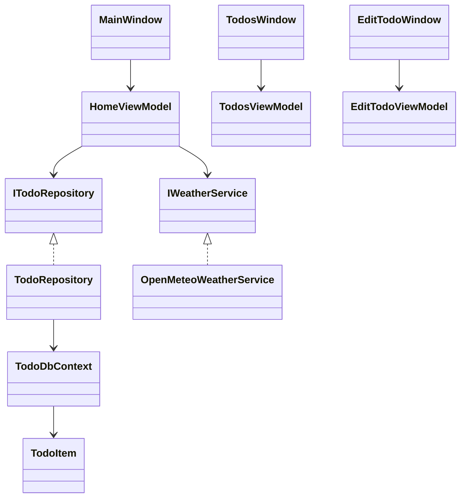

# LifeManagementApp

A desktop life-management app built with **Avalonia UI + .NET 9 + CommunityToolkit.Mvvm**.
Assignment submission for **TT00BI73-3008 Client-Side Programming**.

## What it does

- **Home page**: shows the current weather (Open-Meteo API) and the **Top 3 open todos**
  sorted by *priority (1 = highest), then by *earliest due date*.
  When wind speed exceeds **5 m/s**, a kite reminder banner appears.
- **Todos page**: full list with add / edit / mark-done.
  **Empty titles are rejected** (validation in the edit view).
- **Weather requests** explicitly use `wind_speed_unit=ms` — the API default is km/h,
  which would break the 5 m/s kite threshold.

## How to run

```bash
dotnet run
```

Requires the .NET 9 SDK. Data is stored in a local SQLite file (`todos.db`),
created automatically on first launch (EF Core `EnsureCreated`).

## Project structure (MVVM)

```text
Models/       TodoItem          — plain data entity (Id, Title, Priority, DueDate, IsDone)
Data/         TodoDbContext     — EF Core mapping to SQLite
Services/     ITodoRepository   — persistence contract (interface)
              TodoRepository    — EF Core implementation
              IWeatherService   — weather contract
              OpenMeteoWeatherService — real API client (HttpClient, async)
ViewModels/   HomeViewModel, TodosViewModel, EditTodoViewModel — UI state
Views/        MainWindow, TodosWindow, EditTodoWindow — windows bound to ViewModels
```

Dependency injection: `App.OnFrameworkInitializationCompleted` builds a
`ServiceCollection` (Singletons: `IWeatherService`, `ITodoRepository`;
Transient: `MainWindow`) and resolves `MainWindow` from it.

## Class diagram



## How AI was used (required section)

During this project I used an AI assistant (Claude via OpenCode) to:

- generate the initial Avalonia project scaffold and the MVVM wiring shown above;
- explain concepts (abstract classes, interfaces, DI, LINQ, `get`/`set`)
  while I rewrote and reviewed the code by hand;
- debug build errors.

I reviewed every file, can explain every line, and adjusted the code myself
(e.g. the weather request deliberately sets `wind_speed_unit=ms`).
